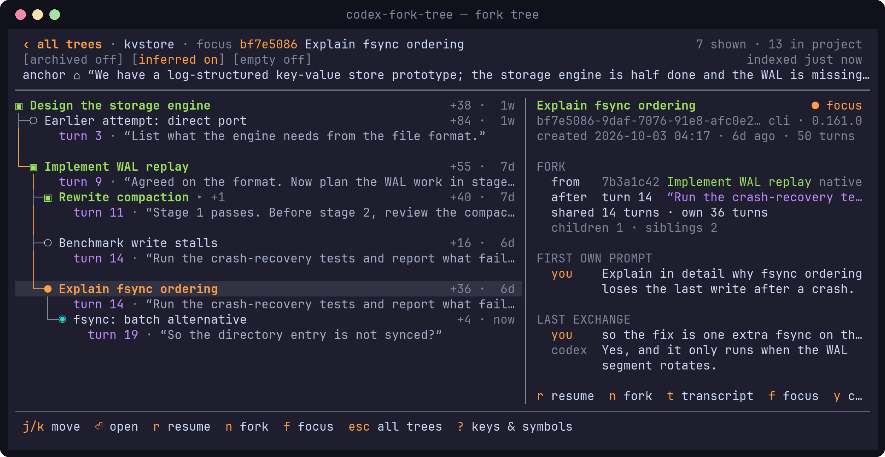
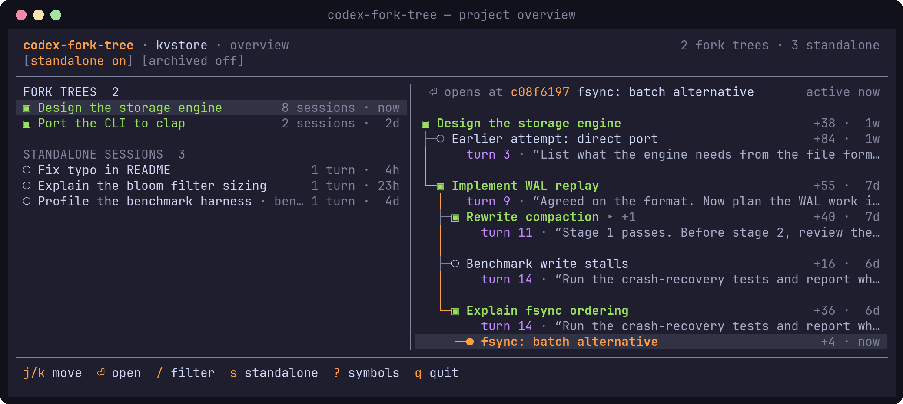
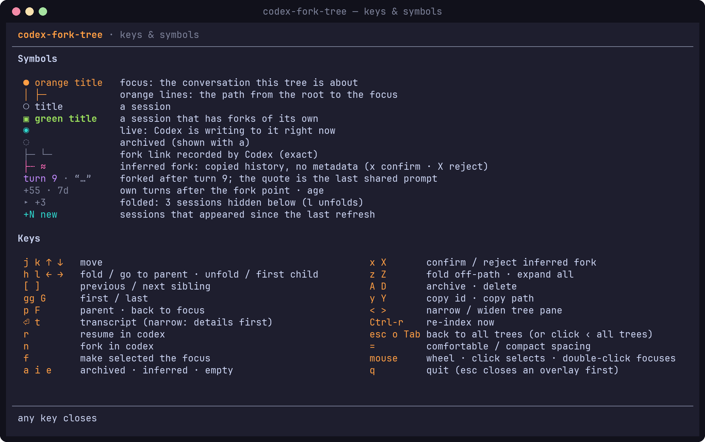

# codex-fork-tree

A terminal UI for browsing a Codex conversation's **fork tree**: the conversation you are in, plus every session that shares a nonempty history prefix with it. That includes forks created before this tool was installed. Subagent sessions are ignored.



Each row is a session, indented under the session it was forked from. The line under a forked session says where it split off: `turn 9 · “the last shared prompt”`. `●` and orange mark the conversation in focus and the path down to it; `▣` marks a session that has forks of its own. Press `?` in the app for every symbol.

Without a session argument it starts with the project overview: every fork tree and standalone session, with a preview of the tree `Enter` will open.



## Install

```sh
cargo install --path .
```

Requires Rust 1.85+. The binary reads `~/.codex` (or `$CODEX_HOME`) and calls the `codex` CLI for resume, fork, archive and delete (`$CODEX_BIN` overrides which binary).

## Use

```sh
codex-fork-tree                    # project overview: pick one of the project's fork trees
codex-fork-tree bf7e5086           # open a session's tree: id prefix, uuid, thread name, or rollout path
codex-fork-tree --last             # skip the overview: open the most recently active session's tree
codex-fork-tree --last 5           # overview of only the trees holding the 5 most recently active sessions
codex-fork-tree list --all         # print the project's trees and standalone sessions
codex-fork-tree --theme latte      # auto | mocha | latte | ansi
codex-fork-tree tree bf7e5086 --width 100   # print the tree once, no colors
codex-fork-tree index --rebuild    # rebuild the project cache
```

| Keys | |
|---|---|
| `Esc` / `o` / `Tab` | back to the project overview: every fork tree in the project (`/` filter, `s` standalone, `Enter` open) |
| `j` `k` / arrows, `gg` `G`, `[` `]`, `p`, `F` | move · first/last · siblings · parent · back to focus |
| `h` `l` | fold or unfold a session's forks, or go to parent / first child |
| `Enter` / `t` | transcript of the selected session (narrow terminals: details first) |
| `r` / `n` | resume / fork in Codex (the TUI suspends and comes back refreshed) |
| `f` | make the selected session the focus |
| `a` `i` `e` | show archived · inferred · empty sessions |
| `x` / `X` | confirm / reject an inferred fork (`≈`) |
| `A` / `D` | archive (asks `y`) / delete (type the first 4 characters of the id) |
| `y` / `Y` | copy id / rollout path (OSC 52) |
| `z` `Z`, `<` `>`, `=` | fold off-path sessions, expand all · resize the tree pane · comfortable/compact spacing |
| `Ctrl-r`, `?`, `q` | re-index now · keys & symbols legend · quit (`Esc` closes overlays and goes back; only `q` quits) |
| mouse | wheel moves the selection · click selects · double-click focuses (tree) or opens (overview) · click `‹ all trees` to go back |

The layout follows the terminal size: side-by-side panes from 100 columns, stacked from 60, tree only from 40, and a notice below 40×12.

`?` shows the same keys plus a legend for every symbol and color:



## How forks are found

Fork links come from Codex's own metadata (`forked_from_id`, with the cut taken from the ordinal sequence), from forks made through this tool, and, for very old Codex versions, from history copied in one burst at creation. Sessions that merely start with the same prompt are never treated as forks. Full details and validation on real data are in [`docs/06-algorithms.md`](docs/06-algorithms.md). [`prototype/forktree.py`](prototype/forktree.py) is the Python reference implementation; `codex-fork-tree debug-edges --project /` produces the same edge list.

## Screenshots

The images above are renders of the real binary running on invented data (a made-up key-value store project). To regenerate them after a UI change, run `scripts/readme-screenshots.sh`; it needs tmux, Python 3 and Pillow. The script writes a synthetic `CODEX_HOME` (`scripts/make_demo_home.py`), drives the TUI in tmux, captures the screen with its colors, and rasterizes the cells to PNG (`scripts/render_screenshot.py`).

## Files

| Path | What |
|---|---|
| `$XDG_CACHE_HOME/codex-fork-tree/<hash>.json` | per-project cache of parsed rollouts; safe to delete |
| `$XDG_DATA_HOME/codex-fork-tree/ledger.json` | forks created through the TUI and your confirm/reject verdicts |

Rollout files are never written; changes to Codex state go through the `codex` CLI.
